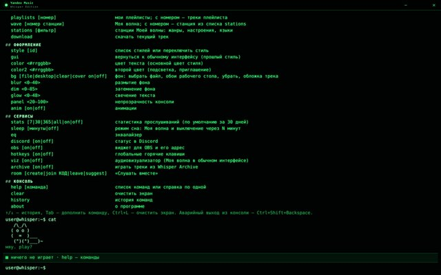

# Whisper Themes

Темы оформления для [Whisper Music](https://github.com/Whisper-Music/YandexMusic-WhisperEdition) — файлы `.wmt`.
Их можно скачать прямо из приложения: **Настройки → Оформление → «Библиотека тем»**.

| | Тема | Автор |
|---|---|---|
|  | **Мел** — школьная доска, всё нарисовано мелом, только белое и серое | Whisper Music |
|  | **Ночное небо** — синий акцент и звёздный фон | Whisper Music |
|  | **Телевизор** — ламповый телевизор: пиксельные надписи, ручки громкости и каналов | Whisper Music |
|  | **Терминал** — весь интерфейс в командной строке | Whisper Music |

Тему можно поставить и вручную: скачай файл из папки [`themes/`](themes) и перетащи его в окно приложения
(или «Загрузить тему…» в настройках).

## Как устроен репозиторий

```
index.json              ← список тем: его читает приложение (собирается скриптом, руками не правится)
themes/<id>.wmt         ← сами темы; имя файла = manifest.id темы
previews/<id>.jpg       ← картинка для карточки в библиотеке (jpg, png или webp, до 2 МБ, лучше 640 × 400)
tools/build-index.js    ← собирает index.json
tools/wmt.js            ← разборщик .wmt — копия src/wmt.js из приложения
```

Приложение берёт отсюда только эти три вида файлов и только из ветки `main`
(`raw.githubusercontent.com/Whisper-Music/whisper-themes/main/…`). Тема из библиотеки проходит ту же
проверку, что и файл, загруженный вручную: CSS не может грузить ничего из интернета и не выполняет код.

## Как добавить свою тему

1. Сделай тему по гайду [THEMES.md](https://github.com/Whisper-Music/YandexMusic-WhisperEdition/blob/main/docs/THEMES.md)
   и проверь её в приложении («Загрузить тему…»).
2. Заполни в `manifest`: `id`, `name`, `author`, `description`, `version` (при каждом обновлении темы —
   новая версия: по ней приложение предлагает «Обновить»).
3. Положи файл в `themes/<id>.wmt`. Превью — `previews/<id>.jpg` (640 × 400, скриншот окна с темой).
   Если отдельного превью нет, скрипт возьмёт картинку `manifest.preview` из самой темы.
4. Запусти `node tools/build-index.js` (нужен Node.js 18+) — он проверит тему и обновит `index.json`.
   Теги (`tags`) для поиска допиши в `index.json` руками — при пересборке они сохраняются.
5. Открой pull request. Проверка в GitHub Actions убедится, что `index.json` совпадает с темами.

Требования:

* `id` — латиница в нижнем регистре, цифры и дефис; не `neon`, `royal`, `steam`, `lolitta`;
* файл темы — не больше 64 МБ (и лучше заметно меньше: его скачивают все);
* шрифты и картинки в теме — только с лицензией, которая разрешает распространение (например, SIL OFL);
  текст лицензии положи в архив темы рядом со шрифтом.
