# Whisper Themes

Темы оформления для [Whisper Music](https://github.com/Whisper-Music/YandexMusic-WhisperEdition) — файлы `.wmt`.
Их можно скачать прямо из приложения: **Настройки → Оформление → «Библиотека тем»**.

| | Тема | Автор |
|---|---|---|
| 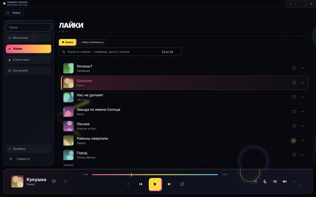 | **Аксиома** — тёмная математическая геометрия: кольца, орбиты, треугольники | Whisper Music |
| 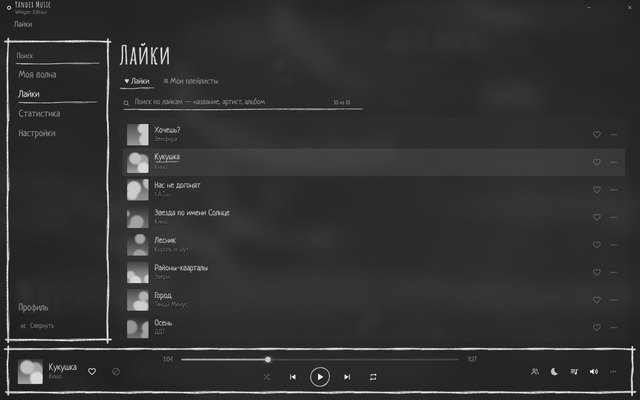 | **Мел** — школьная доска, всё нарисовано мелом, только белое и серое | Whisper Music |
| 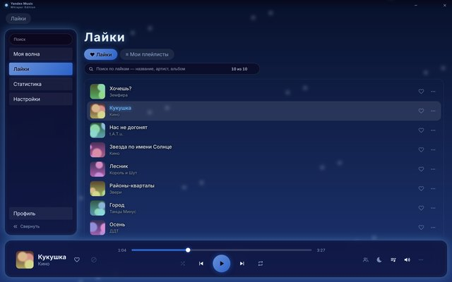 | **Ночное небо** — синий акцент и звёздный фон | Whisper Music |
| 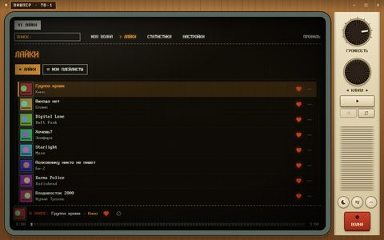 | **Телевизор** — ламповый телевизор: пиксельные надписи, ручки громкости и каналов | Whisper Music |
|  | **Терминал** — весь интерфейс в командной строке | Whisper Music |
| 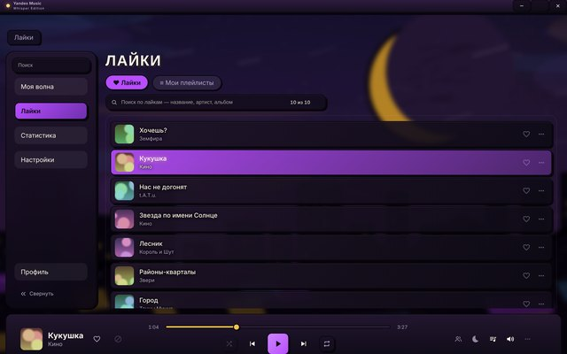 | **Cartoon** — тёмный комикс: толстая обводка, жёсткие тени, жёлто-фиолетовый акцент | Whisper Music |
| 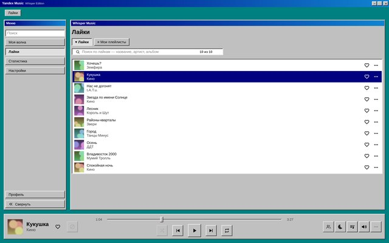 | **Windows 98** — серые окна, синие заголовки, старые кнопки | Whisper Music |
| 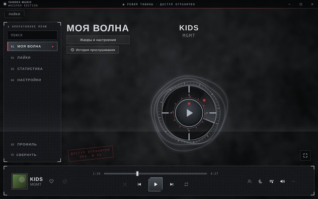 | **Спецназ** — мрачный графит: бетон, кевлар, сталь, прицел вокруг «Моей волны» | Whisper Music |
| 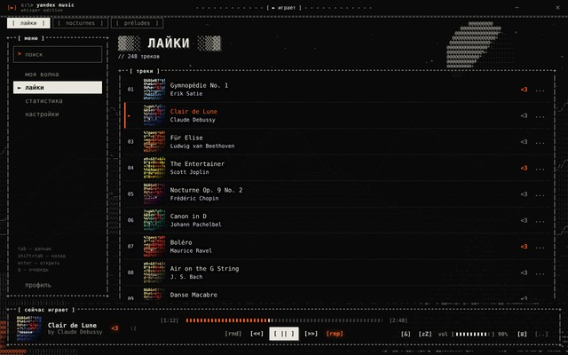 | **ASCII** — всё окно нарисовано символами: рамки ╔═╗, [кнопки], обложки из букв, фон — ASCII-картина, «Моя волна» — крутящийся пончик из donut.c | Whisper Music |

### По артистам

| | Тема | Артист | Автор |
|---|---|---|---|
| 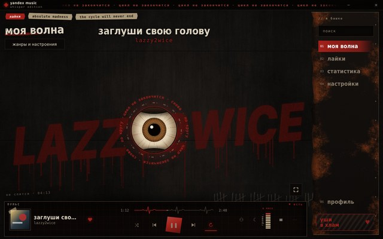 | **Цикл** — сепия, ржавчина и кардиограмма: в тишине всё выцветает и шумит, музыка возвращает цвет и пульс; «Моя волна» — глаз, меню — стальная плита. *Есть мат* | LAZZY2WICE | Whisper Music |
| 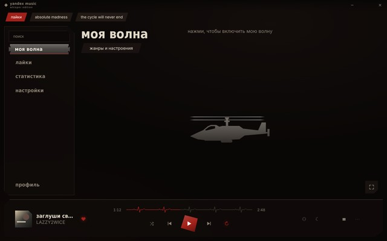 | **Цикл · тихо** — спокойная версия «Цикла»: сепия в тишине и цвет с музыкой, перемотка-кардиограмма, кровь на кости — без шума и перегруза | LAZZY2WICE | Whisper Music |
| 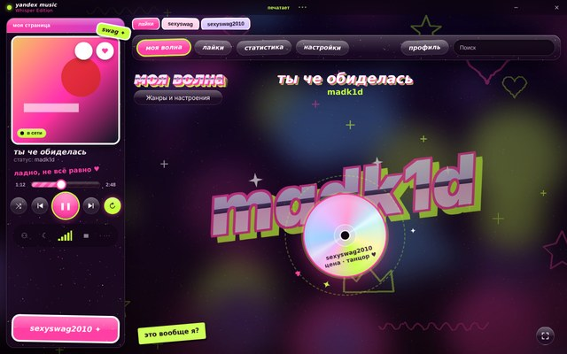 | **sexyswag** — интернет-угар 2010-го: глянец, стикеры, блёстки и хром; плеер — «моя страница» со статусом «в сети», «Моя волна» — голографический CD, под «мне всё равно» прячется «не всё равно» | madk1d | Whisper Music |

Тему можно поставить и вручную: скачай файл из папки [`themes/`](themes) и перетащи его в окно приложения
(или «Загрузить тему…» в настройках).

## Как устроен репозиторий

Темы разложены по папкам — так же они выглядят в «Библиотеке тем» в приложении:

```
themes/whisper/<id>.wmt     ← темы Whisper Music
themes/community/<id>.wmt   ← темы пользователей
themes/artists/<id>.wmt     ← темы в стиле конкретного артиста
previews/<папка>/<id>.jpg   ← картинка для карточки (jpg, png или webp, до 2 МБ, лучше 640 × 400)
index.json                  ← список тем: его читает приложение (собирается скриптом, руками не правится)
tools/build-index.js        ← собирает index.json
tools/wmt.js                ← разборщик .wmt — копия src/wmt.js из приложения
```

Папку теме не нужно указывать в самом файле: скрипт берёт её по тому, где лежит файл.
`id` должен быть разным во всех папках — приложение различает темы только по нему.
У тем из `artists/` в `manifest` пишется имя исполнителя — `"artist": "КИНО"`: в приложении темы одного
артиста стоят вместе, под его именем.

Приложение берёт отсюда только эти три вида файлов, только из этих трёх папок и только из ветки `main`
(`raw.githubusercontent.com/Whisper-Music/whisper-themes/main/…`). Тема из библиотеки проходит ту же
проверку, что и файл, загруженный вручную: CSS не может грузить ничего из интернета и не выполняет код.

`index.json` — формат 2 (с папками). Версии приложения, которые знают только формат 1 (до папок),
пишут «список тем новее этой версии приложения — обнови приложение».

## Как добавить свою тему

1. Сделай тему по гайду [THEMES.md](https://github.com/Whisper-Music/YandexMusic-WhisperEdition/blob/main/docs/THEMES.md)
   и проверь её в приложении («Загрузить тему…»).
2. Заполни в `manifest`: `id`, `name`, `author`, `description`, `version` (при каждом обновлении темы —
   новая версия: по ней приложение предлагает «Обновить»).
3. Положи файл в `themes/community/<id>.wmt` (тема в стиле артиста — в `themes/artists/`, и добавь в `manifest`
   `"artist": "Имя"`). Превью — `previews/<та же папка>/<id>.jpg` (640 × 400, скриншот окна с темой).
   Если отдельного превью нет, скрипт возьмёт картинку `manifest.preview` из самой темы.
4. Запусти `node tools/build-index.js` (нужен Node.js 18+) — он проверит тему и обновит `index.json`.
   Теги (`tags`) для поиска допиши в `index.json` руками — при пересборке они сохраняются.
5. Открой pull request. Проверка в GitHub Actions убедится, что `index.json` совпадает с темами.

Требования:

* `id` — латиница в нижнем регистре, цифры и дефис; не `neon`, `royal`, `steam`, `lolitta`;
* файл темы — не больше 64 МБ (и лучше заметно меньше: его скачивают все);
* шрифты и картинки в теме — только с лицензией, которая разрешает распространение (например, SIL OFL);
  текст лицензии положи в архив темы рядом со шрифтом.
